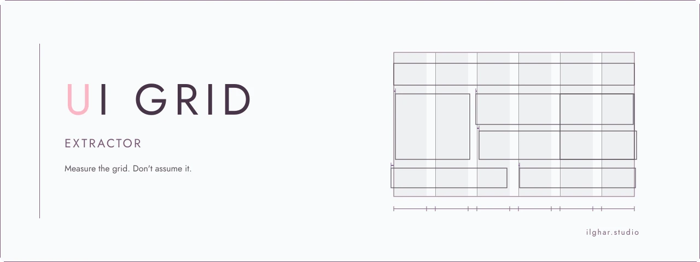

  <a href="https://ilghar.github.io/ui-grid-extractor/">
    <picture>
      <source media="(prefers-color-scheme: dark)" srcset="docs/hero/hero-dark.webp">
      
    </picture>
  </a>

# UI grid extractor

A tool that measures a layout's grid from element boxes, instead of assuming one.

Open the live app: [ilghar.github.io/ui-grid-extractor](https://ilghar.github.io/ui-grid-extractor/) · Repository: [Ilghar/ui-grid-extractor](https://github.com/Ilghar/ui-grid-extractor)

## How it's used

Give it measured element boxes as JSON in px, pt, or mm, with zoom. It tests base units, column guides, and type scale against the measurements. It exports a report, CSS tokens, and an SVG overlay, or keeps an unsupported verdict visible.

The live page includes a grid check you can run in the browser.

[ilghar.studio](https://ilghar.studio)
