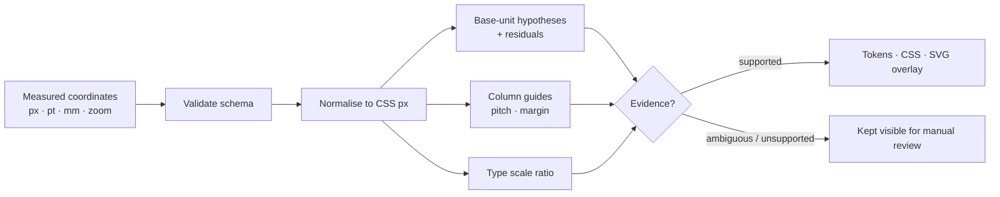
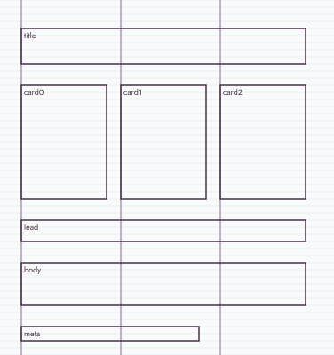
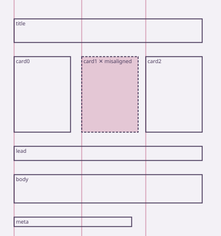

# Measured UI Grid Extractor

**Measure the grid. Don't assume it.** — by ilghar.studio

Designers are told "it's an 8pt grid" about layouts that were never built on one. This tool turns **measured element coordinates** into a grid hypothesis, residuals and design tokens — and refuses to claim a grid, a column system or a modular type scale that the measurements don't support.

## What it does
Give it a JSON list of measured boxes (from your own design file, a spec, or a synthetic fixture). It:

1. **Normalises units** — px, pt (96/72) and mm (96/25.4), dividing out zoom, so a pt measurement at 200% and a px measurement at 100% produce identical tokens.
2. **Tests base units** 2–16px against every coordinate, size and vertical gap; reports fit and residuals for each candidate. Verdict is `supported`, `ambiguous` (e.g. both 4 and 10 fit — neither is chosen silently) or `unsupported` (no grid is claimed).
3. **Finds column guides** from left edges, derives pitch and margin if regular, and **flags misaligned elements** by id.
4. **Detects a modular type scale** (e.g. 12.8 / 16 / 20 / 25 → ratio 1.25) or says it is non-modular.
5. **Exports** a JSON report, CSS custom-property tokens and an SVG overlay in the ilghar.studio palette.
6. **Reports `measured_support`** — the share of token families that are backed by evidence.



## Use it (Python ≥3.11, stdlib only, offline)
```sh
python -m gridx fixtures fixtures/          # write deterministic synthetic fixtures
python -m gridx analyse fixtures/card-8px.json --svg out.svg --css tokens.css
python -m gridx analyse --from-svg fixtures/card-8px.source.svg   # read <rect>/<text> boxes
python -m gridx analyse fixtures/card-misaligned.json --theme dark --svg out-dark.svg
python -m gridx validate my-layout.json     # exit 2 + every schema error listed
python -m gridx verify                      # 7 known-geometry checks
python -m unittest discover -s tests
```

### Real output (`examples/card-8px.tokens.css`)
```css
:root {
  --space-base: 8px;
  --space-1: 24px;
  --grid-pitch: 112px;
  --grid-margin: 24px;
  --grid-columns: 3;
  --font-size-0: 12.8px;
  --font-size-1: 16px;
  --font-size-2: 20px;
  --font-size-3: 25px;
  --font-ratio: 1.25;
}
```
Nudge one card by 3px (`card-misaligned`) and the verdict flips: base unit `unsupported`, `exact: false`, `misaligned: ["card1"]`, drawn in rose on the overlay.

| Clean | Misaligned |
|---|---|
|  |  |

## Evidence rules
- Inputs must be finite numbers: NaN, ±inf, negatives (x/y/w/h) and booleans are validation errors (exit 2), never silently dropped.
- `unit` must be the string `px`, `pt` or `mm`; `zoom` must be finite in [1/64, 64].
- `tolerance` must be finite, ≥ 0 and below 1px after conversion (half the smallest candidate base), so no base can fit trivially.
- A base unit needs **≥ 3 elements**; otherwise the verdict is `insufficient`. Columns need **≥ 3 distinct guides**; otherwise `columns.evidence` is `insufficient` and no `grid.*` tokens are emitted.
- Column guides are clustered from the cluster start (no chaining) and an element is misaligned when it is more than `tolerance` from every guide, so results do not depend on element order.
- Missing or unreadable files exit 2 with `cannot read input`, never a traceback.

## Themes
`--theme light|dark` renders the overlay with the ilghar.studio tokens (`:root` and `.dark` in `ilghar-studio/src/styles.css`). Misaligned elements are dashed, tinted and labelled — never hue-only. The site follows `prefers-color-scheme` and has a persisted, `aria-pressed` toggle. Known palette limits: light `--muted` #7d5a7c is 4.47:1 on canvas (large text only); light accent #856a8e is 2.79:1 (decorative/guides only).

## Deprecated files
`site/card-8px.svg` and `site/card-misaligned.svg` are deprecated and unused; the site uses `site/*.light.svg` / `site/*.dark.svg`. They remain only because this repo is never cleaned up destructively without review.

## SVG source
`--from-svg` reads `<rect>` boxes (with `translate()` groups) and `<text>` boxes that declare their box via `data-top`/`data-w`/`data-h`. Rotated/scaled elements and text without a declared box are listed under `svg_skipped` — never estimated. The bundled SVG yields exactly the same tokens as the JSON fixture.

## Input schema (v1)
`schema_version: 1`, `unit: px|pt|mm`, `zoom > 0` (default 1), `tolerance ≥ 0` (input units, default 0.5), `frame {width,height}`, `elements[] {id (unique), x, y, w>0, h>0, font_size?, role?}`.

## Scope & honesty
- Inputs are coordinates only. **No OCR, no screenshot inference**, no third-party layouts — all fixtures are self-authored with known ground truth.
- Verification is against synthetic geometry; it says nothing yet about accuracy on real hand-measured files.

## Roadmap (original vision)
- Import from machine-readable design metadata (SVG / HTML+CSS computed boxes, design-tool exports).
- Baseline grid vs. cap-height alignment for typography; multi-breakpoint and story/reel safe-area frames (9:16).
- Interactive overlay viewer and side-by-side token diffs; uncertainty intervals on residuals.
- Hand-measured corpus with independent re-measurement to quantify measurement error.

## License
No license granted yet — all rights reserved, ilghar.studio. Private repository.
