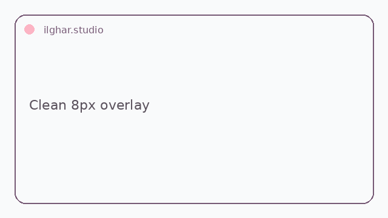
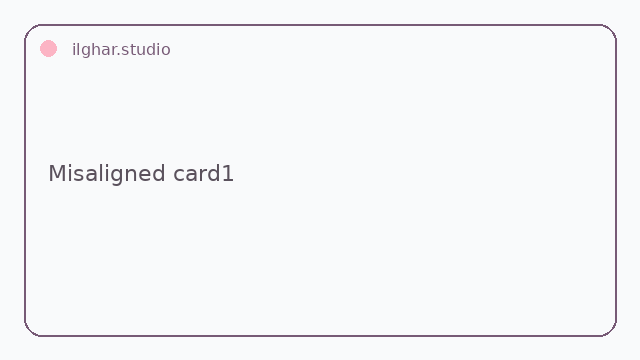

<!-- Copy to the top of every README. Replace REPO, files in docs/hero/. -->

  <a href="https://ilghar.github.io/ui-grid-extractor/">
    <picture>
      <source media="(prefers-color-scheme: dark)" srcset="docs/hero/hero-dark.svg">
      
    </picture>
  </a>

<b><a href="https://ilghar.github.io/ui-grid-extractor/">OPEN THE LIVE APP</a></b> | <a href="#how-it-works">HOW IT WORKS</a>

<!-- Function previews: one per app function, GIF/SVG, each linking into the live app -->
| <picture><source media="(prefers-color-scheme: dark)" srcset="docs/hero/f1-dark.webp"><source media="(prefers-color-scheme: light)" srcset="docs/hero/f1-light.webp"></picture> | <picture><source media="(prefers-color-scheme: dark)" srcset="docs/hero/f2-dark.webp"><source media="(prefers-color-scheme: light)" srcset="docs/hero/f2-light.webp"></picture> |
|---|---|

## How it works
- Give it measured element boxes as JSON in px, pt, or mm, with zoom.
- It tests base units, column guides, and type scale against the measurements.
- It exports a report, CSS tokens, and an SVG overlay, or keeps an unsupported verdict visible.

ilghar.studio
